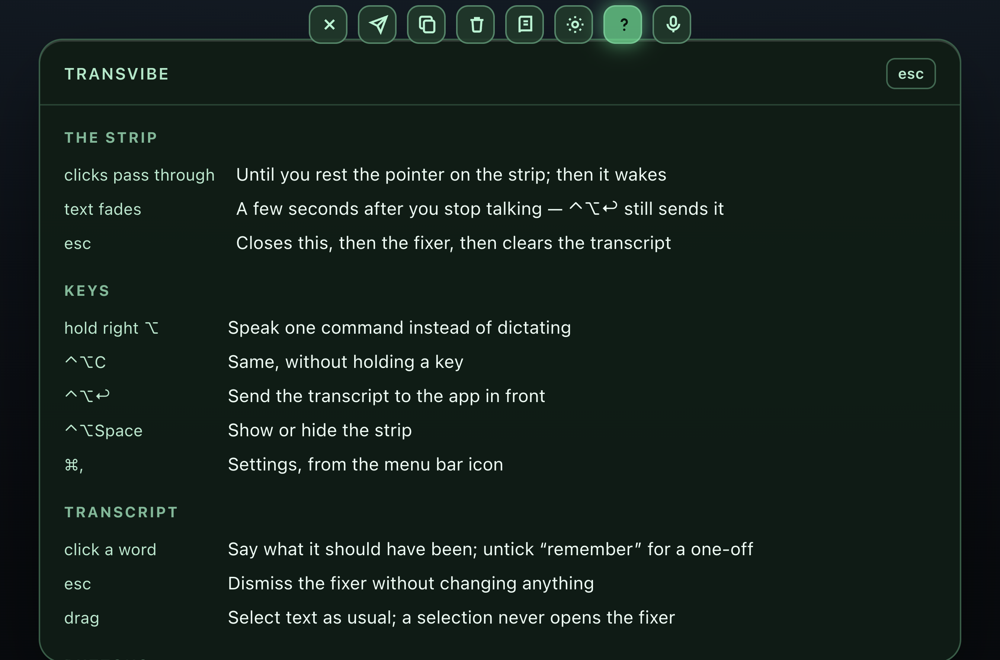
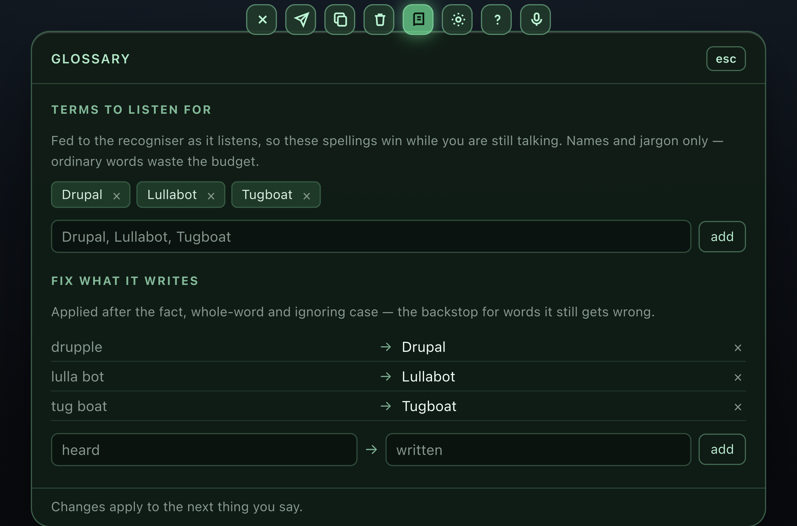

# Using transvibe

The day-to-day reference. [Run instructions are in the README](../README.md).

## The strip

There is no window to move, focus, or close. The app is a transparent band hanging from the top of the screen, above everything including full-screen apps, and **click-through** — every click goes to whatever is behind it.


The ribbon along the top edge is the audio itself — three families of lines over a slowly drifting hue, additively blended so they bloom where they cross. It is flat and dim in a silent room and travels with whatever it hears, which is the fastest way to tell that the microphone is working without saying anything to find out.


### Or the orb

There are two visualizers and you pick one. The ribbon is what runs unless you say otherwise; **Settings › Visuals › The visualizer** swaps it for a round one in its own small window in the lower-left corner of the screen. It is a visual choice and nothing more — the same microphone, the same signals, drawn somewhere else. Nothing about the strip moves either: the transcript, the bubbles and the buttons stay exactly where they are, and the band the ribbon used is simply empty.

It is a ring of filaments, each trailing off a slowly turning circle and each drawn twice — once reflected through the centre, which is what makes it read as a mandala rather than as a spiral. The whole figure breathes outward when the room does and settles when it goes quiet. Like the ribbon it reacts to music and to people talking in the next room, because it is fed from the microphone rather than from the transcript.


It says everything the ribbon says. Command mode washes it amber. Whoever is answering colours it. And the app's own voice, which on the strip is a second small ribbon, is here the smaller ring turning the other way inside it — the same picture at a smaller radius, so there is one thing on screen that the app speaks through rather than two.


**Rest the pointer on it** and three controls fade in, in the hole in the middle: mute, which stops the microphone; a handle, which drags the orb somewhere else; and a close button, which hides transvibe the same way ⌃⌥Space does — it is still listening, it is just not on the screen. Muting shows as a red microphone until you press it again, from either the orb or the strip.

**Drag it by the handle** and it stays where you put it, across restarts and onto whatever display the strip is on. The corner is only where it starts: what is in the lower-left of your screen is not what is in mine. It can sit against an edge if you want it to, but never half off one. **Double-click the handle** to put it back in the corner.


It is click-through everywhere else, corners included — the handle is a button rather than the orb itself for that reason: a circle you could grab anywhere would be a circle that swallows every click that lands on it — hovering it costs you nothing, and only the two buttons themselves ever take a click. There is no dwell: unlike the strip, which you sweep across on the way to the menu bar, the orb sits in a corner nothing else is trying to reach.

**Rest the pointer on it and it wakes**: the words become clickable and the buttons appear. Move away and it is a ghost again. Waking takes a deliberate dwell, so sweeping up to the menu bar never steals a click, and only the text, the buttons and the panels count — a click in the empty air between them reaches the app underneath even while the pointer is on the strip.

**The text fades.** Six seconds after the last thing you said, the transcript fades out. It is still there to send with ⌃⌥↩, but it is now stale: the next thing you say starts a fresh transcript rather than appending to something you can no longer see. Speaking, or reaching for the strip, brings it back. `esc` clears it outright.

**And then it is forgotten.** Twenty seconds after it fades, a transcript nobody has come back to is thrown away — the text, and the undo history with it. The mic hears the whole room, and music, a podcast, or someone stopping by to ask you something all get transcribed the same as dictation; none of it should still be sitting on the strip an hour later waiting for a ⌃⌥↩ meant for something else. Speaking again, or resting the pointer on the strip, restarts the clock. Settings › Visuals sets the delay, or drags it all the way left to keep the text until you clear it yourself.

The strip grows to fit what it is showing, and the transcript itself caps at four lines — older text scrolls off the top.

## Controls

The controls only exist while the strip is awake. They sit in a row directly under the transcript, not off in a corner: hovering the text is what woke the strip, so the pointer is already there.

| | |
|---|---|
| Close (×) | Clear the transcript and get out of the way |
| Copy | Copy the full transcript |
| Clear | Empty the transcript |
| ➤ | Send the transcript to the frontmost app |
| Click a word | Correct it, optionally saving the fix to the glossary |
| Book | Glossary — terms to recognise, and fixes for the ones it misses |
| Gear | [Settings](settings.md) — everything else, applied as you change it |
| ? | In-app help — keys, buttons, and the full command list |
| hovering any button | Describes it on the status line under the row |
| Pause | Stop feeding segments to the recogniser |
| `esc` | Closes the fixer, then a panel, then clears the transcript |
| `⌃⌥Space` | Show/hide the strip from anywhere |
| Hold right `⌥` | Speak one command instead of dictating |
| `⌃⌥C` | Same, without holding a key |
| `⌃⌥↩` | Send the transcript to the app in front |

## Command mode

By default everything you say is transcribed. **Hold the right ⌥ key** and the strip swings amber — speak one editing command, release, and it drops straight back to transcribing. (**⌃⌥C** does the same thing without the hold, for when the key is awkward.) If you say nothing it disarms itself after 6 seconds.

The name of whoever is listening appears on the ribbon while it is armed, in that agent's colour — the same indicator an open conversation uses. Amber says something is listening; the name says what, which is the question you actually have. The key names nobody, so it reaches whoever runs commands, however many names the roster has.

    "open settings"                "close the panel"
    "capitalize that"              "delete the last three words"
    "uppercase that"               "delete that" / "scratch that"
    "lowercase that"               "undo that" / "never mind"
    "new paragraph"                "replace whisper with Whisper"
    "question mark"                "copy that" / "clear everything"
    "send that" / "ship it"        "switch to SDSU"

### Two in one breath

Commands chain: **"open settings and change the voice to Karen"**, "copy that then clear everything", "delete the last word, then capitalize that". Joined with *and*, *then*, *and then* or a comma, up to four in a sentence, run left to right, with one spoken confirmation at the end rather than one per part.

It is all or nothing. Every part has to parse as a real command before any of them runs, because "and" is a word that turns up inside commands as well as between them — half a chain executed on a misreading is worse than no chain. The split is only tried after the whole sentence has failed to parse on its own, so "replace cat and dog with pets" is still one replace, and "set the rate to two hundred and fifty" is still one number.

Releasing the key does not end command mode on its own: the utterance is usually still open when your thumb comes up, and the recogniser needs its silence window to close it. Release just starts the idle timeout — the command is consumed when the utterance actually finishes.

Anything the rules cannot place is shown as `not a command: "…"` rather than guessed at, so nothing you said is silently swallowed. With [`commandFallback`](assist.md) on, that miss goes to the local assist model first, which makes phrasings like "nope, take that back" or "stick that on the clipboard for me" work without adding a rule for each one.

### Names

There is a third way in, with no key at all: **open the sentence with a name** and the rest of it is addressed to whoever you named.

    "hey Claude, delete the last three words"
    "hey Claude, replace whisper with Whisper"
    "hey Claude could you uppercase that"

This is the one that works while a transcript is already sitting on the strip, and while your hands are somewhere else. The strip swings amber as soon as the phrase is recognised in the open utterance — before you have finished the sentence — and shows the command without its keyword, which is exactly what the parser is about to be handed.

Said on its own, a name just arms command mode for the next thing you say, the same as ⌃⌥C.

The names are yours, and there can be more than one. **Settings › Agents** (or say "open agents") is the list: what each one is called, what saying it does, and the voice it answers in. One that *runs commands* is everything above; one that *talks back* is a conversation, below. The model list says what each one costs and what it did — `gpt-oss:20b — 20.9B, 14 GB, 1.6s last answer`. The size and parameter count come from Ollama; the timing is the last answer that model actually gave you, kept because it is the only one of the three that settles anything. A 30B model answers in two and a half seconds where a 20B answers in one and a half, and nothing about the sizes predicts that.

A chat agent also chooses whether that model **thinks first** or **answers straight**, next to the model itself — the same model is a different agent with reasoning on. Thinking is slower but better reasoned; be warned that not every model can be told to skip it, and one that cannot answers with its reasoning inside the reply, which then gets read out. A model with no reasoning at all — llama3, gemma3 — has the switch greyed out rather than hidden, since it was live a moment ago for a different model. Only a chat agent is offered the choice: the jobs a commands agent does with its model are mechanical rewrites on a tight clock, where reasoning is a second spent on nothing.

Each also names the local model it uses — the one that runs commands hands it the guesswork (what an unrecognised command meant, how to shorten a confirmation), the one that talks back answers with it — so a small fast model can decide whether you said "delete that" while a bigger one answers your questions. Each gets a colour of its own, which is what the speaking ribbon wears while that one is talking, so you can see and hear which of them replied.

The name has to come first. A name recognised anywhere would turn "I told him hey Claude was down" into a command; recognised only at the front, after fillers like "um" and "so", it stays out of ordinary speech. Near misses are forgiven, because a small model hears an unusual name loosely — "hey cloud" and "hey claud" both count — with two rules that only matter once there is more than one name: a name heard exactly always beats one heard nearly, and two names equally close to what was heard match **nothing**. Guessing is how you address the wrong one, so the strip says `heard a name, but not which one` and the words go down as dictation. Turn the forgiveness off under Settings › Agents.

Because the app decided this was a command rather than you, an utterance that reaches the parser and means nothing to it is **put back into the transcript** rather than dropped: `not a command — kept "…"`. The key path does not do that — there you meant a command, so being told is better than a stray sentence appearing.

### Settings, by voice

**"open settings"** brings the panel up — the strip is shown first if it was hidden, so it always opens onto something you can see — and **"close the panel"** puts it away, which is what esc does for hands that are on the keyboard.

The same sentence that edits the transcript can change the app. Say the setting's name and what you want done with it:

    "hey Claude, turn off spoken replies"      any on/off setting
    "hey Claude, set the fade to ten seconds"  any slider
    "hey Claude, raise the threshold"          a nudge either way
    "hey Claude, make the voice Karen"         any English voice on this Mac
    "hey Claude, what's the threshold"         ask instead of change

Sliders take the number however you say it — "zero point zero three", "0.03", "two hundred", "a thousand" — and are clamped to the range the panel allows, so "set the frame rate to a thousand" gets you 60 rather than an unusable app. A bare number on a setting measured in milliseconds is read as seconds, because "set the fade to ten" is how people say it and nobody wants a ten-millisecond fade. A nudge is a quarter of where the setting currently sits, rounded to a step the slider can land on.

One sentence is read two ways: "change voice to Karen" is also a valid *replace* — swap the word "voice" for the word "Karen". A sentence that names a setting is treated as being about that setting, and that preference applies only against replace; every other command shape is unambiguous. If you genuinely need to edit the word "voice" in the transcript, "replace voice with Karen" still does it.

The rules are generated from the settings panel itself, so the two can't drift apart, and the panel updates under you if it happens to be open. Twenty-five settings are reachable. The wake phrase, the language, the send target, the Space markers folder and the two model paths are not: they are free text, and a misheard wake phrase would take the voice commands with it. The `?` panel lists the names to say.

The verb and the setting's name have to be adjacent, which is what keeps this out of ordinary speech — "turn off the lights" names no setting and is transcribed as what it is. A settings change is not on the transcript's undo stack; undo it by saying the opposite.

### Switching to a Space, or an app

macOS will not tell you a desktop's name or switch to one on request. The workaround is a *marker*: a tiny app assigned to one desktop, which drags you there when it is activated — see [space-markers](https://github.com/sirkitree/space-markers). Point **Settings › Sending › Space markers folder** at a folder of `<Name> Space.app` bundles and their names become sayable, alongside every app you have open:

    "hey Claude, switch to SDSU"
    "go to home" / "jump to hivemind" / "take me to elk grove"
    "switch to slack" / "go to chrome"     ← any app that is running

With two displays there are two current desktops, so **"switch to home and communications"** moves both — each marker takes the display it lives on, and the last one named is left in front. It is all or nothing, like a chain: if one name does not resolve the whole sentence stays dictation, which is what keeps "switch to home and send it" working as two commands instead of one confused jump. Two markers on the same display can't both be in front of you, and the strip says so rather than letting one of them look ignored.

**Any running app is a name too**, with no setup at all — Slack, Chrome, Telegram, whatever is open. The list is fetched at the moment you say a sentence that starts with the verb, so it is never stale, and it is only the running apps rather than everything installed: a short list keeps half a name unambiguous, and words like *Notes* and *Music* stay ordinary speech while those apps are closed. Half a name works where it is the end of one — "chrome" reaches Google Chrome, "grove" reaches Elk Grove — because the part people drop is the front. A marker wins a name outright when both could be meant.

The name has to be one of the markers or apps that actually exists, which is the whole reason this is safe to say out loud: with no folder set there are no names, and "go to the store" is a sentence rather than a command. An initialism is matched however whisper wrote it down — "SDSU", "SD SU" and "S.D.S.U." all reach the same desktop — and a prefix is enough when only one marker starts that way. Two that both could be meant match neither: landing on the wrong desktop costs you the trip back as well.

It chains, so "switch to hivemind and send it" jumps there and pastes. "Switched to home and communications" is spoken a moment before it is true, for the same reason as *send* — a line said after the switch is a line about a desktop you have already left.

The jump is a **click on the marker's Dock tile**, not `open -a` — opening the app hands it the menu bar and leaves the desktop exactly where it was, which is the one thing macOS does differently for a Dock click. That needs Accessibility, the same grant that pastes on send; without it the strip says so rather than looking like nothing happened.

If the folder has a `markers.json`, its lists are the roster and their `display1` / `display2` grouping is where the shared-display warning comes from; otherwise every `.app` in the folder counts, minus anything with "launcher" in the name, and nothing is known about which screen is which.

### Talking to one of them

An agent set to **talks back** is the other thing a name can mean. Nothing it hears is parsed: address it and the sentence is a question, answered out loud in that agent's voice.

    "hey Ada, what's the capital of France"
    "how far is that from London"          ← no name needed, it is still listening
    "stop talking"                          ← whoever you are addressing

A conversation with a chat agent shows as a running back-and-forth under the transcript: your side and its answers, each as its own bubble, growing down the screen turn by turn — not just the latest reply. It is shown, it is said out loud, and it is **never part of the transcript**. ⌃⌥↩ sends what you dictated, not what was asked or answered; a model's words landing in your document because you asked it something out loud would be a genuinely bad surprise. Anything you dictated stays visible above the bubbles, because it is still what ⌃⌥↩ sends.

The whole thread is what gets sent back to the agent on every turn, so a follow-up can lean on anything said earlier in the conversation, not just the last exchange.

The thread stays open for **Settings › Agents › A conversation stays open for** (25 s by default) after each answer, so a follow-up needs no name. While it is open, a small dot with the agent's name sits on the ribbon — it outlasts the text fading, so you can tell at a glance whether the next thing you say will be taken as a follow-up. Saying nothing lets it lapse, and "stop talking" ends it as well as cutting off the reply; Esc, the trash button and "clear all" end it too. All the way left on that slider means every turn is addressed by name.

**Borrowing another agent** mid-conversation does not hang up. "Hey Trinity, copy the answer" runs that one command in Trinity's voice and the thread is still open to Mira for whatever you say next. The commands that take the whole transcript — *copy*, *send*, *clear* — can name the thread instead: "copy the answer", "send the answer", "copy the conversation", "clear the conversation". Said plainly — "copy that", "erase all" — they mean the transcript, and only stand in for the thread when there is no transcript to act on; "erase all" and "start over" clear both. "Send the answer" is the one deliberate way a model's words get into your document.

A handful of commands work whoever you are addressing — *stop talking*, *pause*, *resume*, *hide*, *close the panel*, *open settings*, *open agents* — because you must be able to interrupt it and should not have to switch names to close a window. Everything else said to a chat agent is a question, including sentences that look like commands: "delete that" asked of Ada is a question about deleting things.

It runs on [Ollama](assist.md), on this machine, like the rest of the model work here. Give the agent its own model in the Agents tab — the small model doing the cleanup is fast but will invent things (asked what a VAD is, it offered "video-assisted delivery"; llama3 gets it right). The prompt asks for one or two sentences and for uncertainty rather than a guess, and a long answer is cut to its first sentences: the microphone is deaf for as long as the speakers are busy, so a paragraph is not a verbose answer, it is half a minute of not being able to say anything.

### It answers out loud

A command you gave with your voice gets an answer in the same key: **"deleted the last three words"**, "copied", "not found". The point is the same one the wake phrase is making — while you are dictating you are looking at the app the words are going into, and a confirmation you have to look up at the strip to read is one you will not read.

A small amber ribbon appears in the middle of the strip while it talks — the same visualizer as the one along the top, in miniature and turned around. (With [the orb](#or-the-orb) running it is the smaller ring inside it instead, turning the other way, which is the same idea in the shape the orb is already in.) The one along the top is the room, measured through the microphone; this one is the app, and it cannot be measured at all: `say` plays to the speakers and the microphone is deaf for exactly that window, so it is drawn from a synthesised spectrum instead. It is honest about the one thing it claims, which is *when*.

The microphone stops listening for exactly as long as the reply takes, plus a fraction for the room's echo, so the app never transcribes itself. (Echo cancellation is on and is not enough on its own — the speakers are a foot from the mic, and an app that hears the wake phrase in its own confirmation is an app that talks to itself.) Nothing is lost while it is deaf: what you say next opens a fresh utterance.

The wording is the assist model's when [it is running](assist.md) — it shortens the strip's own line into something worth hearing — and the strip's line as written when it is not. Either way it is describing what already happened; the model is handed the outcome, so it cannot announce one that did not occur.

Each agent has a voice of its own, picked in **Settings › Agents**; changing it says a line back in that voice straight away, which is the only real way to choose one. The voice under *How they answer*, further down the same tab, is just the default for agents that have not chosen — and saying "change your voice to Karen" changes whoever you are addressing rather than that default. Turn replies off entirely, or set the default pace, in the same place.

The list is the English voices this Mac has — the replies are written in English, so the other 140 are not offered. More install under System Settings › Accessibility › Spoken Content and show up without a restart; a non-English one can still be named by hand in `settings.json`.

### Moving a panel

Any panel — settings, agents, the glossary, this help — is **dragged by its title bar**, and stays where you put it. Double-click the title bar to send it back to the middle.

It is worth knowing why the strip grows when you drag one down: the window is what catches the pointer, and anything drawn past its bottom edge is not merely clipped but unclickable. So the window follows the panel down, and shrinks back to a ribbon when it closes. A position that no longer lands on this screen — put down on a second display, reopened on the laptop alone — comes back to the middle rather than opening somewhere you cannot reach.

The **?** button opens an in-app help panel with the full list (`esc` or `?` toggles it too). It is generated from the parser, so it cannot describe a command the parser does not have.



## Music in the room

A microphone that listens all the time hears the room, and a small Whisper model will happily turn a song into a sentence. Five things stop that, and none of them touches the visualizer — the ribbon still dances to whatever is playing, because it is fed from the microphone directly rather than from the transcript.

The first one is different in kind from the rest. It stops music becoming words; the other four recognise the words afterwards and throw them away.

**A detector that is asked whether anyone spoke.** Whisper answers "what was said" and has no way to answer "nothing" — handed twelve seconds of a song it returns `so`, or a sentence it invented. So it is not asked first. A small speech detector (Silero, under a megabyte, downloaded once beside the model) scores the sound for human voice, and whisper is handed only the parts that scored, or nothing at all. Measured here: a chord, a melody, pink noise, silence and two clips of real music all come back empty, while speech comes through untouched — down to a half-second slice of an utterance still in progress. It costs 23ms on a twelve-second chunk and pays that back whenever it fires, because there is then nothing to decode. The strip says `ignored — no speech`. **Settings › Listening › Ignore anything that is not speech** turns it off, and **How sure the detector has to be** (0.5) is the dial: higher ignores more of the room and eventually starts costing you quiet or distant speech. Both restart the recogniser, which takes about a second.

The four below still run, and still matter — they are what catches whatever the detector lets through, and they are the whole defence on a machine where it could not be downloaded.

**The recogniser's own confidence.** Whisper reports how sure it was, per utterance, and the gap is not subtle. Measured against this app's own server: real speech comes back at an average log probability of −0.01 to −0.08, while a chord, a fan and a pure tone land at −0.65, −0.76 and −0.64. Anything below **Settings › Listening › Ignore anything less certain than** (−0.5 by default) is thrown away, and the strip says `ignored — not speech` so you can see it working while you tune it. All the way right turns the check off. (`no_speech_prob`, which sounds like the field for exactly this job, reads 0.0000 for music and is no use at all.)

**The tag the model writes on purpose.** The bigger models do not guess at music, they *label* it — `Sad music.`, `[soft piano]`, `♪ ♪`, or a run of them, `Sad music. Tap. Sad music.` This is the model being right, so it is confident, so the confidence floor above never fires on it. It gets caught on the words instead: an utterance whose every word is in a short list of sound words, with at least one of them naming a sound, is a caption rather than a sentence and is dropped. One ordinary word anywhere in it is enough to make it speech again, which is why "The music was good." and "Tap the button twice." come through untouched. The bargain is the same one the glossary makes at the other end: dictating nothing but "Sad music." does nothing.

**The decoder stuck in a loop.** The other thing a big model does over music is latch onto a short phrase and say it over and over — "I'm sorry. I'm sorry. I'm sorry. Amen." Every repeat is an ordinary sentence at ordinary confidence, so nothing above catches it and no list of words could; the shape of the utterance is the only tell. Three or more short fragments with one of them repeated three times, or four with half of them repeats, is thrown away. The cost is that saying "No. No. No." on its own does nothing.

**A noise floor that keeps learning.** The detector adapts to how loud the room is, but it used to do that only while the room was quiet — so music playing continuously read as speech forever, and the floor stayed frozen at whatever the room was when the track started. Now a level that has stayed up for twenty seconds without a single dip is treated as the room rather than as a sentence: nobody talks that long without a gap. The floor climbs, the music stops registering, and talking over it still works because speech has to clear the background by a margin rather than clear a fixed number.

## The glossary

Names, jargon and product words are what a small Whisper model gets wrong most consistently — it has never seen them, so it reaches for the nearest thing it has. Two lists attack that from opposite ends: **terms** are fed to the recogniser as it listens, so the spelling wins while you are still talking; **fixes** rewrite what it got wrong anyway.

**Click a word in the transcript** to say what it should have been. The rewrite always happens; what you keep is the opt-out. *Remember the fix* saves it as a rule, and *listen for it too* adds the corrected spelling to the terms — untick both and the word is simply fixed here and now, which is what a one-off mishearing deserves. Both checkboxes hold their setting for the rest of the session, so a run of throwaway fixes is one click, not one per word.


Esc, the *esc* button, or a click anywhere outside dismisses it without changing anything. Dragging still selects text; only a click that leaves no selection opens the fixer. The "heard" side stays editable, which is how a two-word phrase gets a rule.



The book button opens the glossary panel: terms on top, fixes below, added, edited and removed in place. **✎ on a fix** puts it back in the form it was written in — change either side and *save* replaces it, Escape backs out. **Several spellings of one mistake** go in together, separated by commas: `Mirror, Myra, Meera` → `Mira` becomes three rules, each removable on its own. Every edit is written to the settings file and swapped into the running recogniser immediately — the model stays loaded, and the change takes effect on the next thing you say.

The same data lives in the settings file, if you would rather paste a list in:

```json
{
  "vocabulary": ["Drupal", "Lullabot", "Tugboat", "transvibe", "Claude Code"],
  "corrections": {
    "trans vibe": "transvibe",
    "drupple": "Drupal",
    "lolabot": "Lullabot",
    "mirror, myra, meera": "Mira"
  }
}
```

Keep the terms to words that actually get mangled — a long list of ordinary English is worse than a short one. [Why, and what a fix actually matches](architecture.md#the-glossary).

## Sending the transcript

Dictating into a HUD is only useful if the text can get where you actually want it. **⌃⌥↩** (or the ➤ button, or saying *"send that"*) pastes the transcript into whatever app is in front — no copy, switch, paste.

It pastes rather than typing the text out keystroke by keystroke: pasting is instant and cannot mangle characters the target app treats specially.

The subtle part is focus. If transvibe has focus, ⌘V would land in its own window, so it hides first — which returns macOS focus to whatever app you were in before. Triggered by the global shortcut it never had focus at all, and the target is already frontmost. Set `sendTarget` in settings to an app name (e.g. `"Warp"`) to always focus that app first regardless.

| setting | default | |
|---|---|---|
| `sendTarget` | `null` | app to focus before pasting; null means whatever is in front |
| `sendPressesEnter` | `false` | also hit Return after pasting |
| `clearAfterSend` | `true` | empty the transcript once it has been delivered |

This needs **Accessibility** permission to post the keystroke — a different grant from the Input Monitoring that the right-⌥ tap uses. Without it the text is still on the clipboard and the status line says so, so the fallback is the old copy-and-paste rather than nothing.

## Menu bar

transvibe lives in the macOS menu bar as a waveform icon. Left-click toggles the strip; right-click opens a menu with show/hide, a listening checkbox, copy and clear, the three panels (Settings ⌘,, Glossary, Keys & commands), Launch at login, Reveal model folder, and Quit.

The three panel entries show the strip on the way, since a panel opened onto a hidden window is nothing to look at.

Hiding parks the app in the menu bar with the model still resident, so bringing it back is instant rather than a fresh model load. It comes back without stealing focus from what you were typing in. Only Quit (or `⌘Q`) actually tears down the engine.
